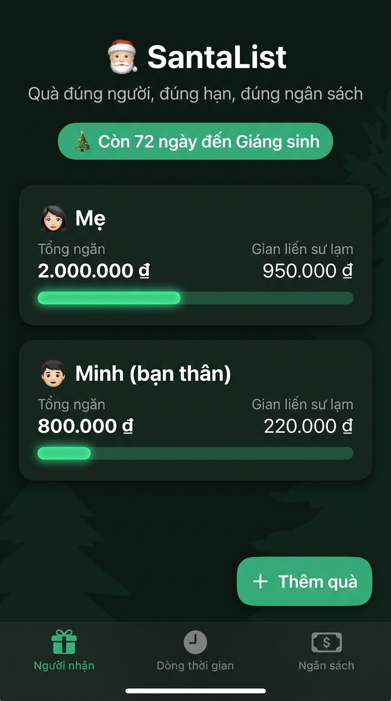
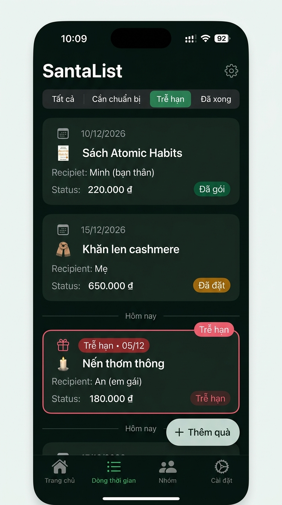
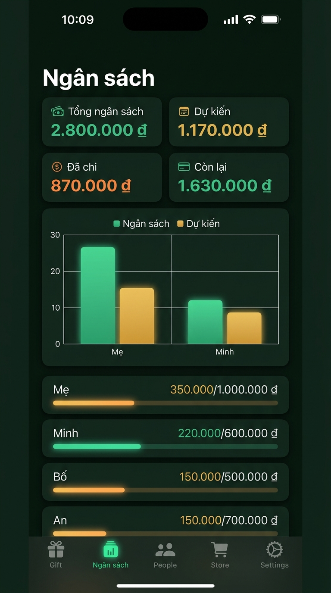

# 🎅 SantaList: Gift Tracker (iOS Native)

> **"Quà đúng người, đúng hạn, đúng ngân sách"**

Ứng dụng quản lý quà tặng Giáng sinh và các dịp lễ hội thuần **iOS Native (Swift 5.9+ & SwiftUI)**, lưu trữ dữ liệu hoàn toàn trên máy bằng **SwiftData**, biểu đồ trực quan với **Swift Charts**, nhắc lịch thông minh qua **UserNotifications**.

Ứng dụng không sử dụng bất kỳ thư viện bên thứ ba nào (không CocoaPods, không SPM ngoài Apple SDK), bảo mật riêng tư tuyệt đối (offline-first, không gọi mạng, không analytics, tuân thủ `PrivacyInfo.xcprivacy`).

---

## 📸 Giao diện ứng dụng (Screenshots)

| Tab | Chế độ Sáng (Light Mode) | Chế độ Tối (Dark Mode) |
| :--- | :---: | :---: |
| **Tab 1: Người nhận**<br>Quản lý người thân, tiến độ ngân sách |  |  |
| **Tab 2: Dòng thời gian**<br>Sắp xếp theo hạn chót, cảnh báo trễ hạn |  |  |
| **Tab 3: Ngân sách**<br>KPIs chi tiêu & Swift Charts trực quan |  |  |

---

## ✨ 10 Chức năng cốt lõi

1. **Quản lý người nhận**: Thêm, sửa, xóa người nhận (tên, ngân sách VNĐ, ghi chú). Khi xóa người nhận, toàn bộ quà liên quan sẽ tự động bị xóa theo cơ chế **Cascade Delete** với hộp thoại xác nhận an toàn.
2. **Quản lý quà tặng**: Mỗi món quà thuộc 1 người nhận, hỗ trợ các trường: tên quà, giá tiền, hạn cần có (DatePicker hỗ trợ nút bỏ hạn), dịp lễ (Giáng sinh, Sinh nhật, Kỷ niệm, Khác), ghi chú và link cửa hàng.
3. **Tương tác trạng thái quà nhanh**:
   - Chạm vào chip trạng thái để chuyển bước kế tiếp: `Ý tưởng` ➔ `Đã đặt` ➔ `Đã nhận` ➔ `Đã gói` ➔ `Ý tưởng`.
   - Nhấn giữ (Context Menu) để chọn trực tiếp bất kỳ trạng thái nào.
   - Vuốt thẻ quà để xóa (có xác nhận).
4. **Dòng thời gian thông minh**:
   - Quà được tự động sắp xếp theo ngày hết hạn tăng dần, quà không có hạn nằm ở cuối.
   - Quà trễ hạn (hạn trước hôm nay và chưa "Đã nhận") được viền đỏ và hiển thị nhãn `Trễ hạn`.
   - Quà "Đã nhận" hoặc "Đã gói" hiển thị nhãn xanh hoàn thành `Đã xong`.
5. **Trung tâm ngân sách & Biểu đồ Swift Charts**:
   - `Tổng ngân sách` = tổng ngân sách tất cả người nhận.
   - `Dự kiến` = tổng giá tất cả các món quà.
   - `Đã chi` = tổng giá quà từ trạng thái "Đã đặt" trở lên.
   - `Còn lại` = Ngân sách - Dự kiến (đổi màu đỏ cảnh báo khi âm).
   - Thanh tiến độ từng người tự động đổi sang màu đỏ cranberry khi chi phí dự kiến vượt ngân sách.
   - Biểu đồ cột Swift Charts so sánh song song Ngân sách vs Dự kiến theo từng người nhận.
6. **Đếm ngược Giáng sinh ở Header**: Tự động tính số ngày còn lại đến ngày 25/12 năm nay. Nếu ngày hiện tại đã qua 25/12, bộ đếm sẽ tự động chuyển sang đếm đến 25/12 năm sau.
7. **Nhắc lịch thông báo địa phương (Local Notifications)**:
   - Tự động lên lịch thông báo lúc **9:00 sáng trước hạn 1 ngày** cho các món quà chưa nhận.
   - Tự động xin quyền thông báo khi mở ứng dụng lần đầu.
   - Tự động hủy và cập nhật lại lịch khi món quà được chỉnh sửa, thay đổi trạng thái hoặc bị xóa (identifier `gift-<UUID>`).
8. **Bảo mật và riêng tư tuyệt đối**: Toàn bộ dữ liệu chỉ lưu trữ cục bộ trên thiết bị qua SwiftData. Không gọi mạng, không tracking, không CloudKit. Khai báo bảo mật chuẩn file `PrivacyInfo.xcprivacy`.
9. **Dữ liệu mẫu khởi tạo**: Tự động nạp dữ liệu mẫu ban đầu (sử dụng cờ trong `UserDefaults`):
   - Mẹ: Ngân sách 2.000.000 ₫ (Khăn len cashmere 650.000 ₫ - Đã đặt hạn 15/12; Bộ trà thảo mộc 300.000 ₫ - Ý tưởng hạn 20/12).
   - Minh (bạn thân): Ngân sách 800.000 ₫ (Sách Atomic Habits 220.000 ₫ - Đã gói hạn 10/12).
10. **Trải nghiệm iOS chuẩn mực**: Hỗ trợ đầy đủ Dark Mode theo hệ thống, Dynamic Type, Accessibility Labels, hỗ trợ tiếng Việt mặc định (String Catalog `Localizable.xcstrings`, có sẵn tiếng Anh), định dạng tiền tệ VNĐ chuẩn `1.250.000 ₫` (`vi_VN`).

---

## 🏗️ Kiến trúc & Cấu trúc thư mục

Ứng dụng được thiết kế theo kiến trúc **MVVM** hiện đại của SwiftUI với `@Observable` và `@Model` của SwiftData:

```text
SantaList/
├── App/
│   ├── SantaListApp.swift          # Entry point, ModelContainer & xin quyền Notification
│   └── SeedData.swift               # Nạp 2 người & 3 quà mẫu khi mở lần đầu
├── Models/
│   ├── Person.swift                 # SwiftData Model người nhận (@Relationship cascade delete)
│   ├── Gift.swift                   # SwiftData Model quà tặng
│   ├── GiftStatus.swift             # Enum trạng thái quà & hàm next() xoay vòng
│   └── Occasion.swift               # Enum dịp lễ (Giáng sinh, Sinh nhật...)
├── Logic/
│   ├── BudgetCalculator.swift       # Tính toán ngân sách, dự kiến, đã chi, còn lại
│   ├── Formatters.swift             # Định dạng tiền tệ VNĐ ("1.250.000 ₫") & ngày tháng
│   └── Countdown.swift              # Logic đếm ngược đến 25/12 (rollover năm sau)
├── Services/
│   └── ReminderService.swift        # Quản lý UserNotifications lúc 9:00 sáng trước hạn 1 ngày
├── Views/
│   ├── ContentView.swift            # TabView 3 tab
│   ├── Components/
│   │   ├── AppHeaderView.swift      # Header đếm ngược Giáng sinh & slogan
│   │   ├── StatusChipView.swift     # Chip trạng thái (tap next, context menu)
│   │   ├── BudgetProgressBar.swift  # Thanh tiến độ đổi màu khi vượt ngân sách
│   │   └── AddEditGiftSheet.swift   # Form thêm/sửa quà có validate
│   ├── People/
│   │   ├── PeopleView.swift         # Tab 1: Danh sách người nhận & nút thêm quà nổi
│   │   ├── PersonDetailView.swift   # Chi tiết người nhận, danh sách quà & ngân sách
│   │   └── AddEditPersonSheet.swift # Form thêm/sửa người có validate
│   ├── Timeline/
│   │   └── TimelineView.swift       # Tab 2: Quà theo hạn chót, cảnh báo trễ hạn
│   └── Budget/
│       └── BudgetView.swift         # Tab 3: KPI cards & biểu đồ Swift Charts
└── Resources/
    ├── Assets.xcassets/             # Bảng màu (Pine Green, Cranberry Red, Dark variants)
    ├── Localizable.xcstrings        # Chuẩn String Catalog tiếng Việt & tiếng Anh
    ├── PrivacyInfo.xcprivacy        # Khai báo bảo mật không thu thập dữ liệu
    └── Info.plist                   # Cấu hình Bundle & quyền iOS
SantaListTests/
├── BudgetCalculatorTests.swift      # Test tính ngân sách, dự kiến, đã chi, còn lại
├── GiftStatusTests.swift            # Test hàm next() xoay vòng, nhãn tiếng Việt
├── OverdueLogicTests.swift          # Test logic phát hiện trễ hạn
├── CountdownTests.swift             # Test đếm ngược 25/12 & rollover qua năm mới
├── FormattersTests.swift            # Test định dạng VNĐ & ngày tháng
└── SwiftDataCascadeTests.swift      # Test xóa cascade bằng in-memory ModelContainer
```

---

## 🚀 Hướng dẫn mở và chạy trên Xcode

### Yêu cầu hệ thống
- macOS Sonoma 14.0+ hoặc mới hơn
- Xcode 15.0+ (khuyên dùng Xcode 15.4 hoặc 16.0+)
- iOS Deployment Target: **iOS 17.0+**

### Các bước chạy trên iOS Simulator:
1. Mở thư mục dự án và nhấp đúp vào file `SantaList.xcodeproj` để mở trong Xcode.
2. Trên thanh công cụ trên cùng (Toolbar), chọn Scheme **SantaList** và thiết bị đích là **iPhone 15** (hoặc bất kỳ thiết bị iOS Simulator 17.0+ nào).
3. Nhấn **`Cmd + R`** (hoặc nút Run hình tam giác) để biên dịch và khởi chạy ứng dụng.
4. Mở tab *People*, *Timeline*, *Budget* để trải nghiệm đầy đủ tính năng.

### Chạy bằng dòng lệnh (Terminal):
```bash
# Build ứng dụng cho iOS Simulator:
xcodebuild -project SantaList.xcodeproj \
           -scheme SantaList \
           -destination 'platform=iOS Simulator,name=iPhone 15' \
           build

# Hoặc dùng script tiện ích tự động boot simulator và mở app:
./scripts/build_simulator.sh "iPhone 15"
```

---

## 🧪 Chạy Unit Test

Bộ test bao gồm toàn bộ các yêu cầu nghiệp vụ: tính ngân sách, xoay vòng trạng thái `next()`, phát hiện trễ hạn, đếm ngược Giáng sinh, định dạng VNĐ, và kiểm tra xóa cascade trong SwiftData in-memory:

### Chạy trên Xcode:
- Nhấn tổ hợp phím **`Cmd + U`** trong Xcode.

### Chạy qua Terminal:
```bash
xcodebuild test \
    -project SantaList.xcodeproj \
    -scheme SantaList \
    -destination 'platform=iOS Simulator,name=iPhone 15' \
    CODE_SIGNING_ALLOWED=NO

# Hoặc dùng script chạy test:
./scripts/test_simulator.sh "iPhone 15"
```

---

## 📲 Hướng dẫn đổi Team & Bundle ID để chạy trên máy thật

1. Mở `SantaList.xcodeproj` bằng Xcode.
2. Trong thanh điều hướng bên trái (Project Navigator), chọn root project **SantaList**.
3. Chọn target **SantaList** ➔ tab **Signing & Capabilities**.
4. Tại mục **Signing**:
   - Tích chọn **Automatically manage signing**.
   - Tại mục **Team**: Chọn Apple Developer Account cá nhân của bạn.
   - Tại mục **Bundle Identifier**: Đổi từ `com.santalist.app` sang Bundle ID duy nhất của bạn (ví dụ: `com.yourname.santalist`).
5. Kết nối iPhone/iPad thật qua cáp hoặc Wi-Fi, chọn thiết bị thật trên thanh Toolbar và nhấn **`Cmd + R`**.

---

## 🔒 Riêng tư & Bảo mật
- Không sử dụng bất kỳ kết nối mạng nào (`URLSession` không được gọi ở bất cứ đâu).
- Không nhúng SDK phân tích, theo dõi hoặc quảng cáo.
- Không kích hoạt iCloud / CloudKit (dữ liệu chỉ lưu trên máy).
- Đã cấu hình tệp `PrivacyInfo.xcprivacy` chuẩn Apple.
