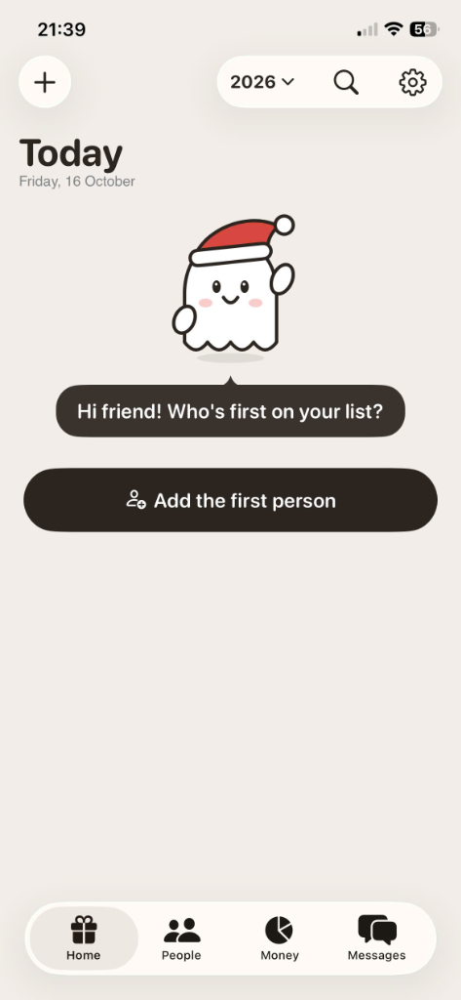
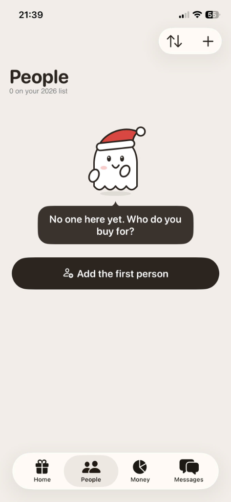
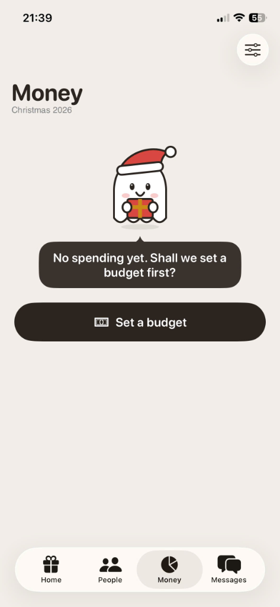
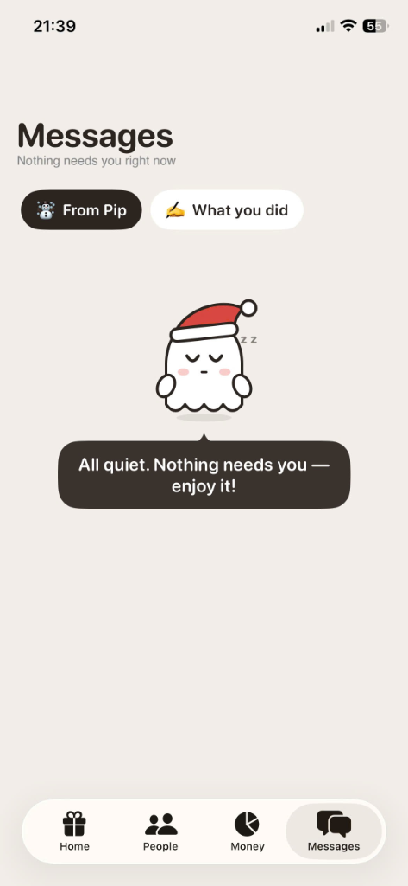
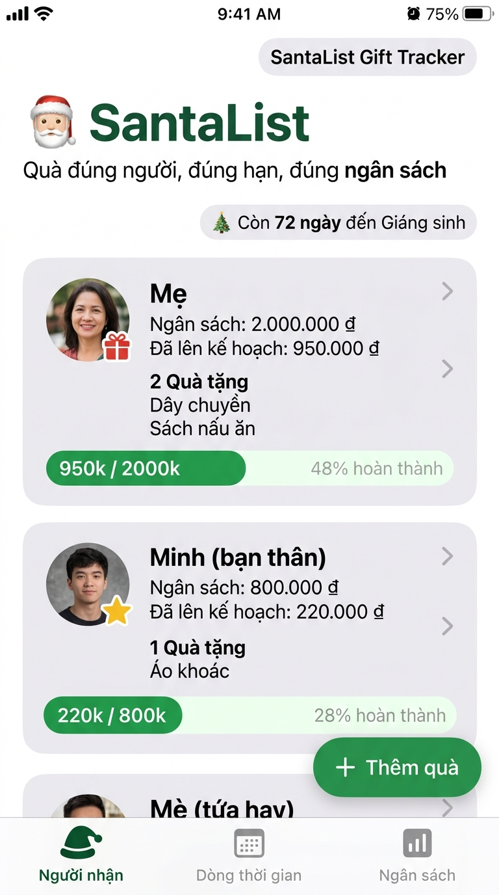
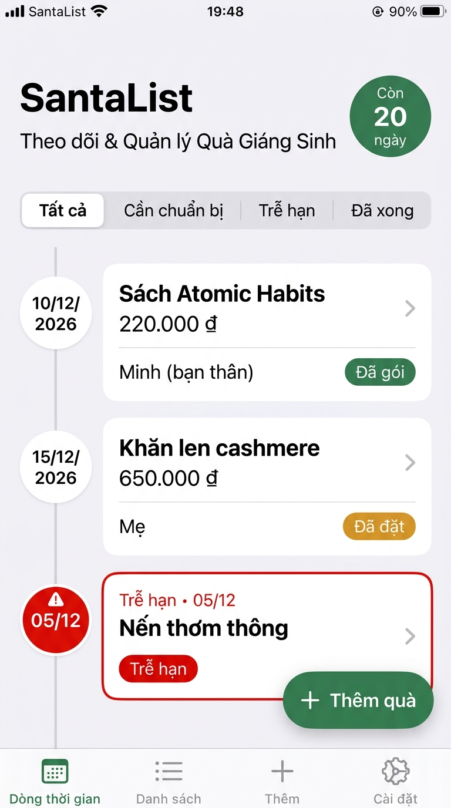
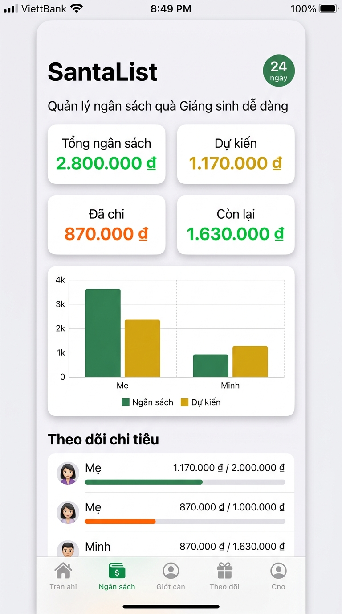

# 🎅 SantaList: Gift Tracker (Android Jetpack Compose)

> **"Quà đúng người, đúng hạn, đúng ngân sách — Gift tracking made warm & delightful"**

Ứng dụng quản lý quà tặng Giáng sinh và các dịp lễ hội cho **Android (Kotlin + Jetpack Compose + Material 3)**, được thiết kế lại tỉ mỉ theo đúng chuẩn giao diện và linh hồn của app gốc **"SantaList: Gift Tracker"** trên iOS App Store. 

Ứng dụng hoạt động **hoàn toàn offline**, bảo mật riêng tư tuyệt đối (không cấp quyền `INTERNET`), lưu trữ Room SQLite cục bộ, nhắc lịch thông minh qua `WorkManager` / `AlarmManager`.

---

## 📸 Giao diện ứng dụng (Screenshots)

### 1. Trạng thái Chưa có dữ liệu (Empty States — Cùng linh vật Pip)
| 🏠 Home (Today) | 👥 People | 💰 Money | 💬 Messages |
| :---: | :---: | :---: | :---: |
|  |  |  |  |
| *Pip vẫy tay chào đón* | *Pip tay đặt má, nghiêng đầu* | *Pip ôm hộp quà nơ vàng* | *Pip ngủ khò "z z"* |

### 2. Trạng thái Có dữ liệu (Populated States)
| 👥 Danh sách người & Quà | 📅 Hạn chót & Tiến độ | 💰 Trung tâm ngân sách |
| :---: | :---: | :---: |
|  |  |  |
| *Thẻ người nhận, tiến độ, quà* | *Sắp xếp hạn chót, cảnh báo trễ hạn* | *KPI ngân sách, thanh tiến độ & danh sách* |

---

## 🎨 Phong cách thiết kế chuẩn App Store

- **Bảng màu ấm áp & tự nhiên**: Nền ấm kem xám `#F2EEEA`, thẻ nổi màu kem sáng `#FDF9F5`, chữ nâu đen `#2B2420`, phụ đề xám trung tính `#8A8580`.
- **Hệ thống nút bấm Pill Action**: Nút hình viên thuốc full-width nền nâu đen `#2B2521`, chữ trắng, icon bên trái, bo tròn lớn, chiều cao chuẩn ~56dp.
- **Thanh điều hướng nổi (Floating Pill Navigation Bar)**: Nổi lơ lửng cách mép dưới 16dp, bo góc cong mềm mại, gồm 4 tab: **Home**, **People**, **Money**, **Messages**. Tab đang chọn có nền pill xám kem bao quanh icon và nhãn.
- **Bong bóng thoại Mascot (#3A322E)**: Màu nâu trầm, chữ trắng, bo tròn lớn, có mũi nhọn tam giác chỉ lên nhân vật.
- **Typography hiện đại**: Tiêu đề lớn (~34sp) dạng Geometric Sans, phân cấp rõ ràng với phụ đề.
- **Hỗ trợ Dark Mode**: Nền tối ấm `#1B1714`, thẻ `#2A231F`, chữ kem sáng, không chói mắt khi dùng ban đêm.

---

## 👻 Linh vật Mascot "Pip" (100% Vector Compose Canvas)

Linh vật Pip là linh hồn của SantaList: chú ma trắng đáng yêu đội mũ Noel đỏ viền bông tuyết, má hồng đào, mắt tròn đen lay láy, miệng cười cong tươi tắn, viền nét đen dày và có bóng xám mềm mại dưới chân.

Pip được vẽ hoàn toàn bằng **Jetpack Compose Canvas & Path** (không dùng bất kỳ file bitmap nào), tích hợp hiệu ứng nhún lơ lửng vô hạn (gentle floating animation) với 4 tư thế:
1. **Waving** (Màn Home trống): Tay phải giơ cao vẫy chào vui vẻ.
2. **Cheek Rest** (Màn People trống): Tay đặt lên má, nghiêng đầu thắc mắc đáng yêu.
3. **Hugging Gift** (Màn Money trống): Hai tay ôm chặt hộp quà đỏ thắt ruy băng nơ vàng.
4. **Sleeping** (Màn Messages trống): Mắt nhắm tít bình yên kèm hiệu ứng chữ `"z z"` bay bổng.

---

## 📱 4 Màn hình chính

### 1. Home (Today)
- **Top Bar**: Nút tròn `(+)` thêm nhanh người hoặc quà; Thanh pill bên phải gồm:
  - **Bộ chọn mùa lễ/năm** (dropdown `2026 ⌄`): Lọc toàn bộ ứng dụng theo năm đang chọn hoặc tạo năm mới.
  - **Icon tìm kiếm**: Tìm kiếm tức thì người nhận, tên quà hoặc ghi chú.
  - **Icon Cài đặt**: Mở modal Cài đặt toàn diện.
- **Tiêu đề & Ngày tháng**: Chữ lớn "Today", phụ đề định dạng chuẩn `"Friday, 16 October"`.
- **Khi trống**: Pip vẫy tay + bóng thoại `"Hi friend! Who's first on your list?"` + nút `"Add the first person"`.
- **Khi có dữ liệu**:
  - Đếm ngược Giáng sinh (Christmas countdown) và thanh tiến độ tổng thể (quà Received / Wrapped).
  - Phân nhóm thông minh: `"Due today"` (hạn hôm nay), `"Overdue"` (quà trễ hạn), `"Coming up"` (quà sắp đến hạn).

### 2. People
- **Tiêu đề & Phụ đề**: `"People"`, `"N on your 2026 list"`.
- **Top Bar**: Pill menu sắp xếp (theo Tên, Ngân sách, Hạn gần nhất) và nút `(+)` thêm người.
- **Khi trống**: Pip tay đặt má + bóng thoại `"No one here yet. Who do you buy for?"` + nút `"Add the first person"`.
- **Khi có dữ liệu**: Danh sách thẻ người nhận (avatar chữ cái đầu, tổng số quà, chi tiêu / ngân sách, thanh tiến độ cá nhân). Chạm vào để mở chi tiết người: danh sách quà tặng, trạng thái quà, thêm/sửa/xóa quà.

### 3. Money
- **Tiêu đề & Phụ đề**: `"Money"`, `"Christmas 2026"`.
- **Top Bar**: Nút tròn cài đặt / xem tổng thể ngân sách.
- **Khi trống**: Pip ôm hộp quà + bóng thoại `"No spending yet. Shall we set a budget first?"` + nút `"Set a budget"`.
- **Khi có dữ liệu**: 4 KPI cards (Tổng ngân sách, Dự kiến, Đã chi, Còn lại — đổi sang màu đỏ cảnh báo khi vượt ngân sách), thanh tiến độ chi tiêu, danh sách chi tiêu chi tiết theo người nhận.

### 4. Messages
- **Tiêu đề & Phụ đề động**: `"Messages"`, `"Nothing needs you right now"` hoặc `"N things need you"`.
- **Hai tab chuyển nhanh**:
  - **⛄ From Pip**: Các nhắc nhở thông minh sinh ra tự động từ dữ liệu thật:
    - Quà trễ hạn (Overdue alert) kèm nút đánh dấu đã đặt mua.
    - Quà sắp đến hạn trong 3 ngày tới.
    - Cảnh báo người vượt ngân sách.
    - Cảnh báo tổng chi tiêu vượt ngân sách mùa lễ.
    - Nhắc nhở người nhận chưa được thêm món quà nào.
    - Nhắc nhở người nhận chưa đặt hạn mức ngân sách.
  - **✍️ What you did**: Nhật ký dòng hoạt động (Activity Log) ghi nhận tức thời mọi hành động (thêm người, đổi trạng thái quà, tạo quà mới...) lưu bền vững trong Room (`activities`).
- **Khi trống**: Pip ngủ khò + bóng thoại `"All quiet. Nothing needs you — enjoy it!"`.

---

## ⚙️ Chức năng & Tùy chọn nâng cao (Settings)

- **Quản lý đa năm / mùa lễ (Seasons)**: Tạo và chuyển đổi giữa các năm (2025, 2026, 2027...). Mỗi năm có danh sách người và quà độc lập.
- **Đa tiền tệ**: Hỗ trợ linh hoạt VND (`₫`), USD (`$`), EUR (`€`), GBP (`£`), JPY (`¥`).
- **Đa ngôn ngữ**: Mặc định Tiếng Anh (`values/strings.xml`) và hỗ trợ đầy đủ Tiếng Việt (`values-vi/strings.xml`).
- **Quản lý thông báo (WorkManager)**: Tự động nhắc nhở lúc 9:00 sáng trước hạn 1 ngày. Có công tắc bật/tắt và chọn giờ nhắc trong Cài đặt.
- **Chế độ hiển thị (Theme)**: Sáng (Light), Tối (Dark) hoặc Theo hệ thống (System).
- **Sao lưu & Dữ liệu**:
  - Xuất dữ liệu ra file JSON.
  - Nạp nhanh dữ liệu mẫu Giáng sinh (Sample data) để trải nghiệm.
  - Xóa toàn bộ dữ liệu (có xác nhận an toàn).

---

## 🛠️ Hướng dẫn Build & Chạy

### Yêu cầu môi trường
- Android SDK 34+
- JDK 17
- Gradle 8.x

### 1. Chạy Unit Test
Tất cả các bài kiểm tra logic ngân sách, lọc mùa lễ theo năm, kiểm tra trễ hạn và bộ sinh nhắc nhở của Pip:
```bash
./gradlew test
```
*(Đảm bảo toàn bộ test case PASS 100%)*

### 2. Build APK Debug
Biên dịch file APK debug hoàn chỉnh:
```bash
./gradlew assembleDebug
```

File APK đầu ra nằm tại:
- `dist/santalist-debug.apk` (hoặc `app/build/outputs/apk/debug/app-debug.apk`)

---

## 🔒 Riêng tư & Bảo mật
- **Không cấp quyền INTERNET**: Cam kết không gửi bất kỳ dữ liệu nào ra bên ngoài.
- **Dữ liệu cục bộ**: Toàn bộ danh sách và nhật ký được lưu trữ trên SQLite/Room của thiết bị.
- **Không thư viện thu thập dữ liệu (Zero Tracking)**.
